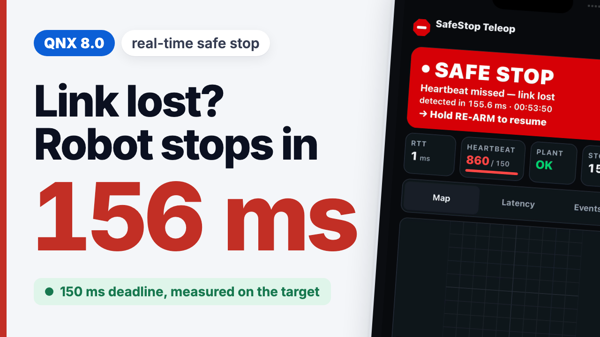
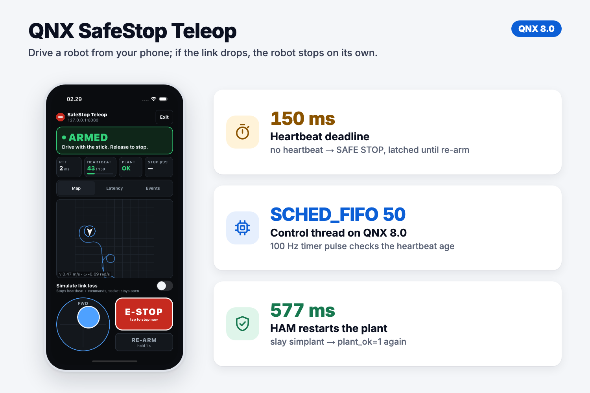
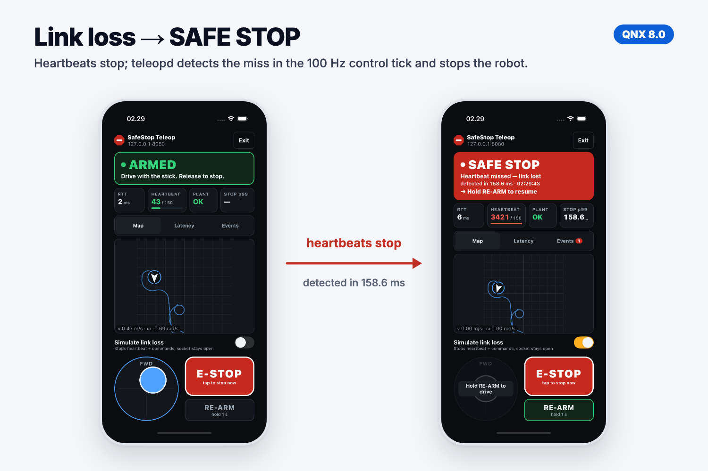
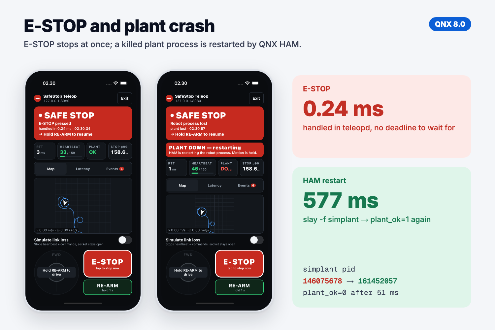
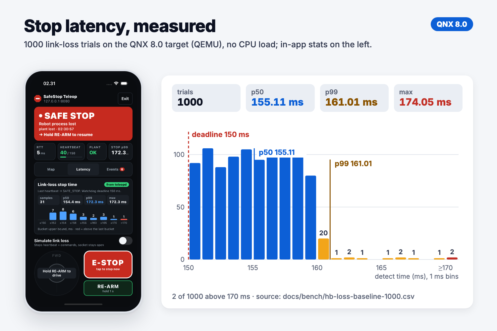
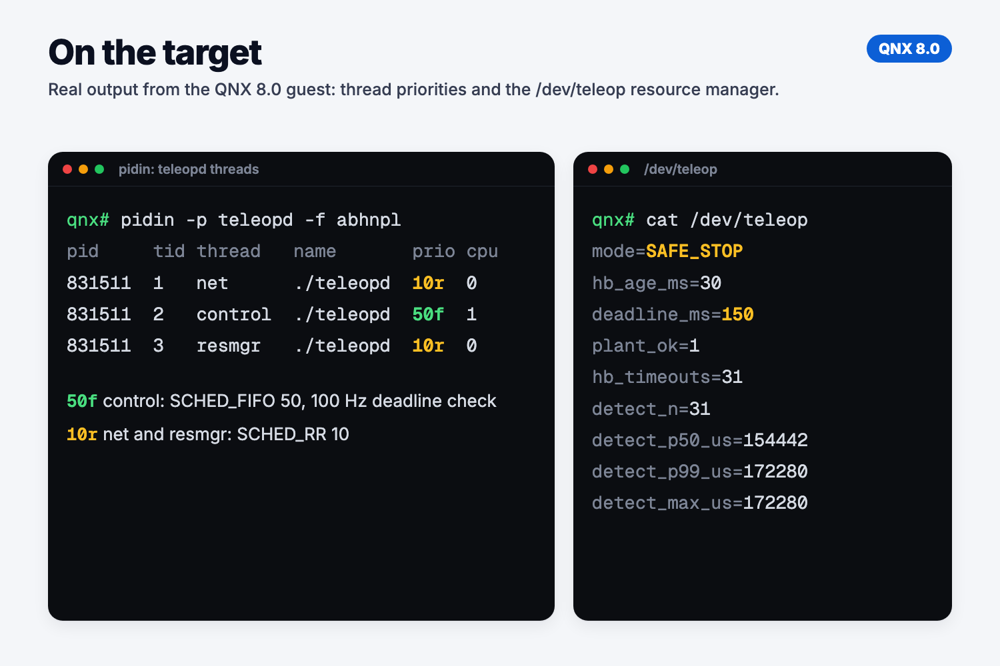
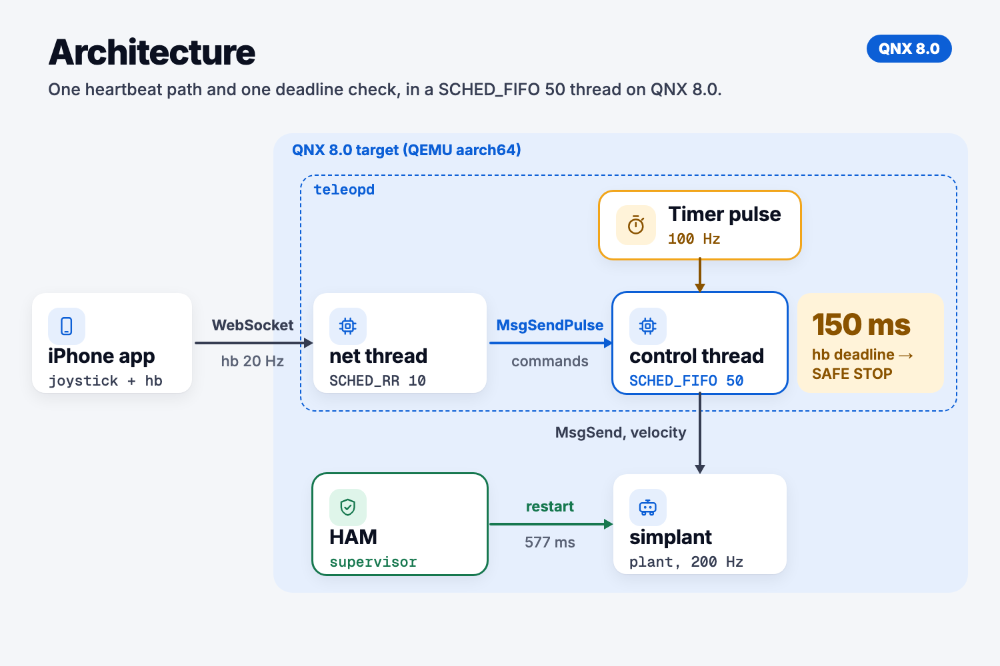
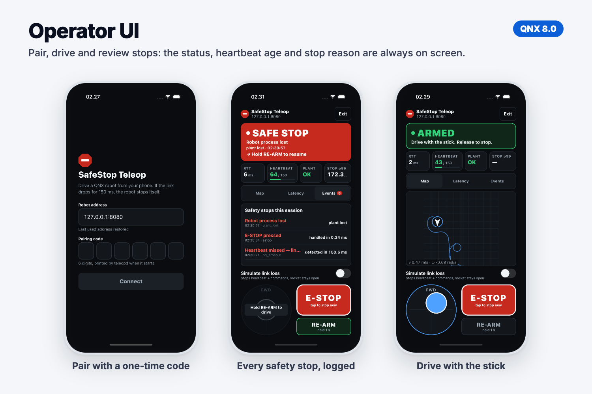

# qnx-safestop-teleop

React Native companion app for teleoperating a robot running on **QNX 8.0**, with a
deterministic **safe-stop**: if the operator's heartbeat misses its 150 ms deadline,
the real-time control loop ramps velocity to zero and locks until re-armed.

Entry for the QNX Global Hackathon — category **Robotics & Medical**.

[](https://youtu.be/asHE8_aUXQs)

**[▶ Watch the 3-minute demo](https://youtu.be/asHE8_aUXQs)**

## Screenshots

| | |
|---|---|
| <br>01 Overview | <br>02 Link loss → SAFE STOP in 158.6 ms |
| <br>03 E-STOP and HAM restart | <br>04 1000-trial stop-latency bench |
| <br>05 Real pidin and /dev/teleop output | <br>06 Architecture |
| <br>07 Operator UI | |

Screenshots and numbers come from the iOS Simulator + QNX 8.0 under QEMU; bench figures are in [docs/BENCH.md](docs/BENCH.md).

## Layout

| Path | Contents |
|---|---|
| `qnx/teleopd/` | WebSocket server + SCHED_FIFO control loop (safe-stop) |
| `qnx/simplant/` | Simulated diff-drive plant (200 Hz), supervised by HAM |
| `qnx/teleopctl/` | Shell client for teleopd's `/dev/teleop` resmgr (status, set-deadline, estop, reset-stats). `set-deadline` accepts 50–1000 ms: values above 150 weaken safe-stop (up to 1 s); root only, logged as WARNING |
| `qnx/hamreg/` | Registers simplant with HAM (death → delay → restart) with a restart limit |
| `qnx/latbench/` | CPU hog (FIFO/RR, configurable priority) for the latency bench |
| `qnx/common/` | Shared headers (protocol, pulse codes, devctl codes) |
| `app/` | Expo / React Native companion app (TypeScript) |
| `tools/qemu/` | Run the QNX image under QEMU (aarch64, hvf/tcg) |
| `tools/fault/` | Fault injection: `cpu-hog.sh` (priority experiments), `slay-plant.sh` (kill simplant, time recovery) — see [tools/fault/README.md](tools/fault/README.md) |
| `tools/sdp/` | QNX SDP setup helpers |
| `docs/` | Architecture, benchmarks, QNX API evidence, codelab |

See [docs/ARCHITECTURE.md](docs/ARCHITECTURE.md).

**Security scope**: teleopd pairs with a 6-digit token over plain `ws://` — fine for a
trusted LAN demo, not for the public internet (no TLS; do not port-forward 8080). Browser
pages are refused by Origin, a second client cannot take over while ARMED, and the QEMU SSH
forward listens on 127.0.0.1 only. Details: ARCHITECTURE "Pairing & threat model".

## Reproduce in 7 steps

Tested from a fresh clone on an Apple Silicon Mac (macOS arm64) with QNX SDP 8.0,
colima 0.x + Docker CLI, QEMU 11.1.3 (TCG), Node 26 / npm, Python 3 (stdlib only).

**Prerequisites**: `brew install colima docker qemu node python`; a myQNX account with a
QNX SDP 8.0 license (e.g. the free QNX Everywhere non-commercial key) and the QNX Software
Center installer `qnx-setup-<version>-linux.run` saved in `~/qnx/`. **Clone under `$HOME`**:
colima only shares `$HOME` with its VM (`tools/sdp/run.sh` refuses other locations).

1. **SDP container** (Ubuntu 24.04 linux/amd64 on the colima profile `qnx`):
   ```sh
   colima start -p qnx --arch aarch64 --vm-type vz --vz-rosetta --cpu 4 --memory 8 --disk 60 --runtime docker
   tools/sdp/run.sh build            # image qnx-sdp-host:latest (QNX_SDP_IMAGE=<tag> to rename)
   ```
2. **QNX SDP 8.0** (one time, interactive myQNX login; **accepts the QSC EULA**):
   `tools/sdp/run.sh /work/tools/sdp/install-qsc.sh`. It syncs and activates your license
   (`qnxsoftwarecenter_clt -addLicenseKey`, key from `QNX_LICENSE_KEY` or a hidden prompt),
   installs baseline `com.qnx.qnx800` into `~/qnx/qnx800` plus the required packages
   `target.qemuvirt`, `target.driver.virtio.devb`, `target.driver.virtio.startup`,
   `target.net.openSSH` and `target.os_services.ham` (HAM; `make-image.sh` puts `ham`,
   `hamctrl`, `libham.so.2` from it into the image). Already have the SDP? Put it at `~/qnx/qnx800` and
   install the packages above. Details: [tools/sdp/README.md](tools/sdp/README.md).
3. **Build** (aarch64le, `-Wall -Wextra`, expect 0 warnings) and the QEMU image. The image
   starts ham, simplant (under HAM) and teleopd (deadline 150 ms) at boot, so there is no
   deploy step. Pick a pairing token now, or leave `TELEOP_TOKEN` unset and read the random
   one from the serial log in step 4:
   ```sh
   tools/sdp/run.sh make -C qnx
   export TELEOP_TOKEN=<6 digits>                   # optional; never commit it
   tools/sdp/run.sh /work/tools/sdp/make-image.sh   # build/qnx-image/output/{ifs.bin,disk-qemu.vmdk}
   ```
   Under amd64 emulation (qemu-user) `as`/`ld` occasionally die with `caught signal 11`; this
   is the emulator, not the code. Rerun `make -C qnx` (it resumes) and delete stray `core` files.
4. **Boot QEMU** on the Mac (TCG; SSH is ready ~10 s after "Startup complete"):
   ```sh
   QEMU_SERIAL=build/qnx-image/serial.log tools/qemu/run-qemu.sh -pidfile build/qnx-image/qemu.pid &
   until grep -q 'Startup complete' build/qnx-image/serial.log 2>/dev/null; do sleep 1; done; sleep 10
   grep -a 'Pairing token' build/qnx-image/serial.log    # random token (if TELEOP_TOKEN was unset)
   export TELEOP_TOKEN=<that token>                       # only in that case
   ```
   Ports default to `127.0.0.1:2222`→22 and `0.0.0.0:8080`→8080 (LAN, for the phone). If
   they are taken, add `QEMU_SSH_PORT=2223 QEMU_TELEOP_PORT=8082` here (8081 is Metro's),
   `QNX_SSH_PORT=2223` to `deploy.sh`, `-p 2223` to `ssh` and `--port 8082` to
   `wsclient.py`/the smoke URL.
5. **Test** teleopd + simplant under HAM (already running; `wsclient.py` reads `TELEOP_TOKEN`):
   ```sh
   python3 tools/wsclient/wsclient.py                         # ends with "20/20 checks passed"
   python3 tools/wsclient/wsclient.py --bench 1000 --csv build/bench/run.csv
   ssh -i build/qnx-image/ssh/id_ed25519 -o IdentitiesOnly=yes -o StrictHostKeyChecking=no \
     -o UserKnownHostsFile=/dev/null -p 2222 root@localhost cat /dev/teleop
   ```
   Changed the QNX code? `tools/sdp/run.sh make -C qnx && tools/qemu/deploy.sh` updates the
   running VM (same start script, no duplicate processes, keeps the token unless
   `TELEOP_TOKEN` is set); rebuilding the image works too.
6. **App** (no device needed for the checks):
   ```sh
   cd app && npm ci && npm run typecheck && npm run lint && npm run test:link   # "ALL PASS"
   npm run mock -- --port 8090 &                     # mock teleopd (8080 is QEMU's)
   npm run smoke -- ws://localhost:8090              # all PASS; kill %1 afterwards
   npm run smoke -- ws://localhost:8080              # same smoke against the VM (TELEOP_TOKEN)
   npx expo start                                    # Expo Go on a phone in the same LAN
   ```
7. **Codelab** watchdog: `tools/sdp/run.sh make -C /work/docs/codelab/watchdog`, then run it
   on the VM as in [docs/codelab/README.md](docs/codelab/README.md) step 5.

Stop the VM: `kill "$(cat build/qnx-image/qemu.pid)"`.

## License

[MIT](LICENSE) © 2026 Bayu Trisnapati
